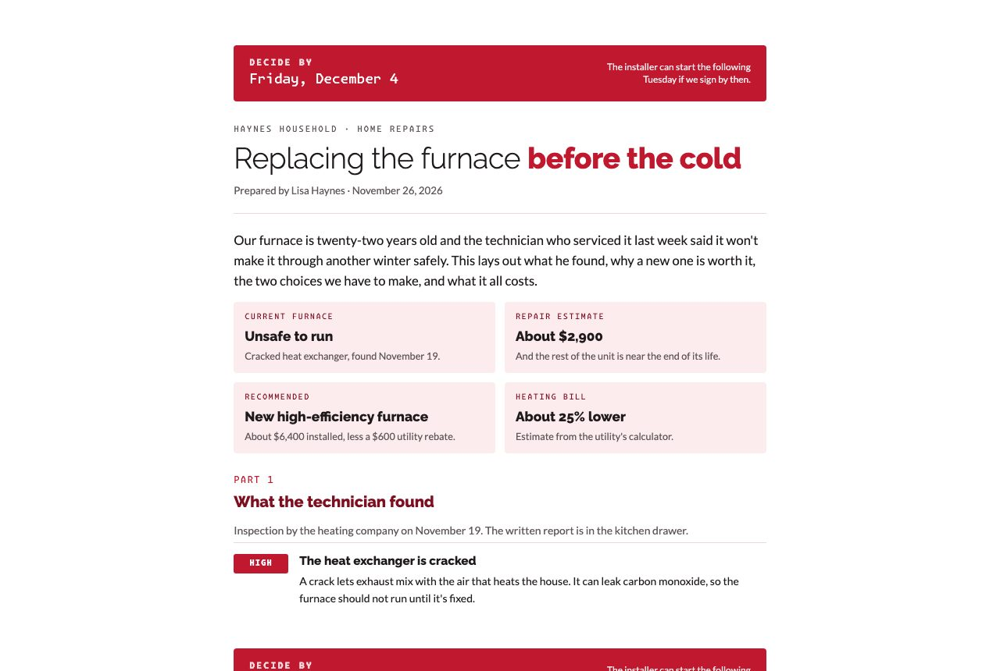
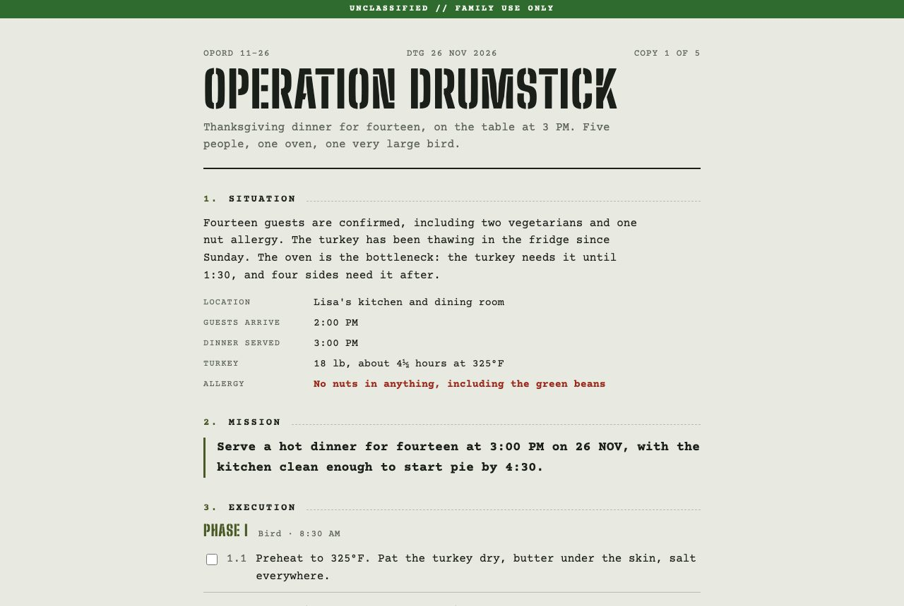
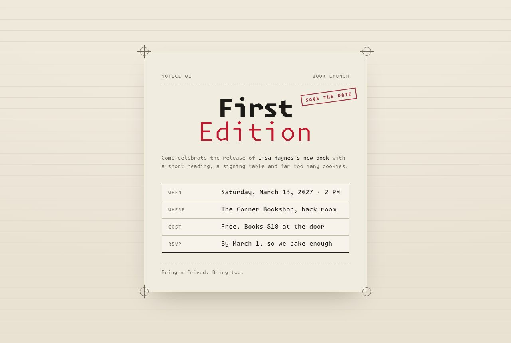
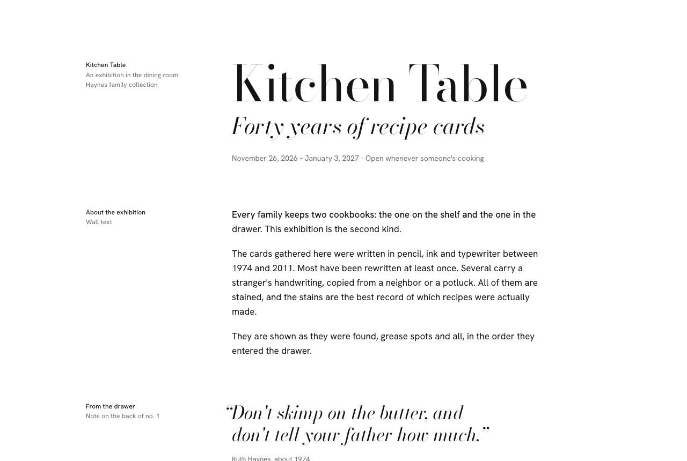
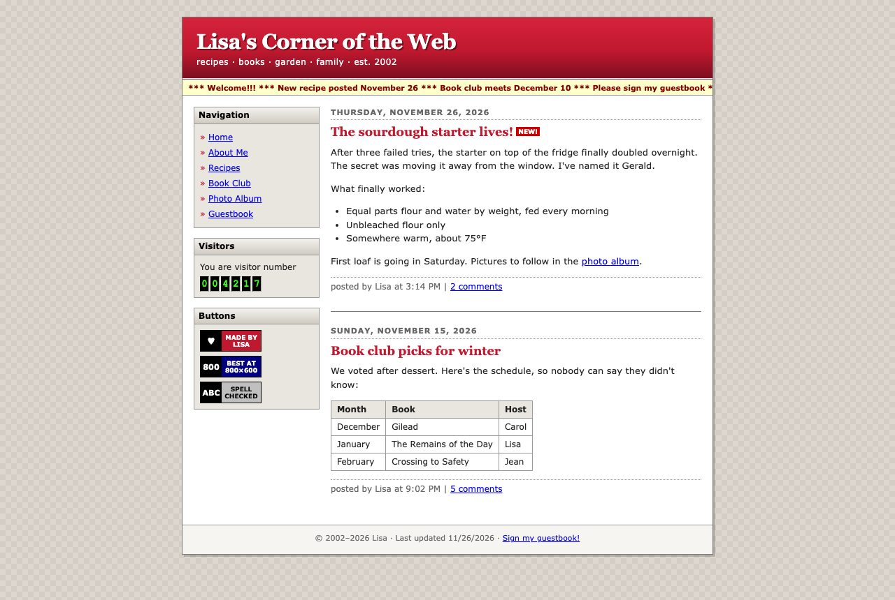
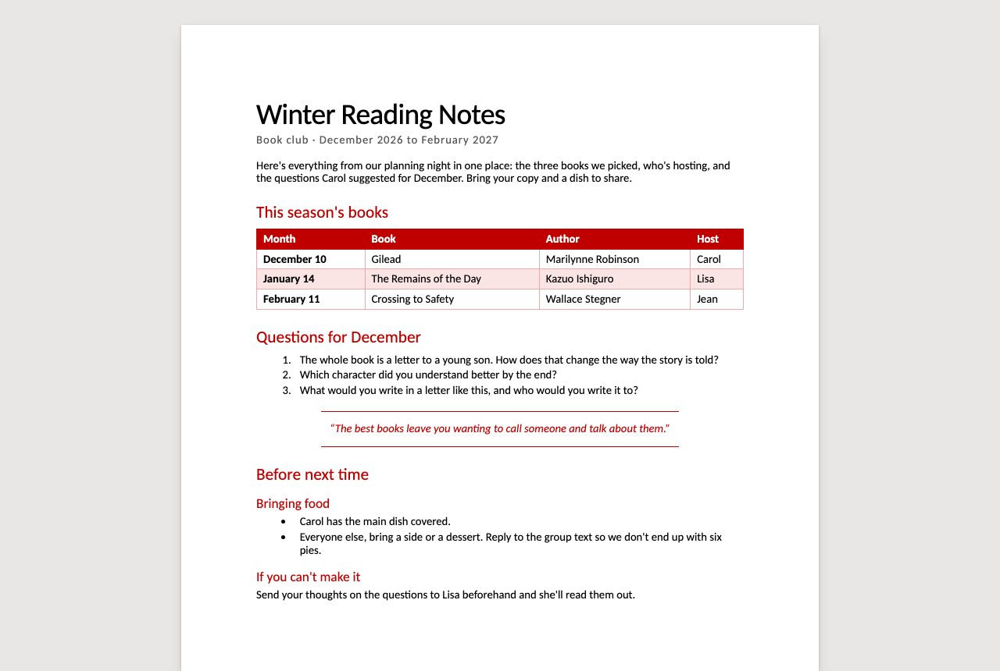

# haynes-skills

The Haynes family's skills for Claude, made by Alex for Lisa. It's a Claude plugin marketplace with one plugin, **haynes**. Once it's installed, every update pushed here reaches her automatically.

## /haynes:document

Six house styles for documents. Ask Claude for a checklist, a report, a notice or some notes, and it builds one from the right template, with the fonts built in, ready to print or send as a PDF.

| | |
|---|---|
| **Report**: write-ups, decisions, costs<br> | **Field order**: step-by-step plans and checklists<br> |
| **Proof sheet**: notices, invitations, save-the-dates<br> | **Gallery**: essays, letters, collections<br> |
| **2002 web**: family updates, newsletters<br> | **Word doc**: plain notes, minutes, handouts<br> |

Claude picks the skill up on its own when she asks for a document, or she can type `/haynes:document`. Try asking:

- "Make a field order for Christmas Eve dinner."
- "Write up the roof estimates as a report."
- "A save-the-date for the reunion, the stamp one."
- "Put my garden notes in the gallery style."

## Install

Printable setup guide for Lisa, made with the skill itself: [Operation Red Ink](docs/Operation%20Red%20Ink%20-%20setup%20guide.pdf).

### Claude app (claude.ai or desktop)

1. Open **Customize → Plugins → Add → Add marketplace**.
2. Enter `alexh/haynes-skills`.
3. Install **haynes**, and turn on automatic sync for the marketplace so updates arrive by themselves.

### Claude Code

```bash
claude plugin marketplace add alexh/haynes-skills
claude plugin install haynes@haynes-skills
```

Then run `/plugin`, open **Marketplaces**, select **haynes-skills** and turn on auto-update.

## Updating

Push to `main`. The plugin has no `version` field on purpose: each commit counts as a new version, so installed copies update on their next sync.

## Layout

```
.claude-plugin/marketplace.json
plugins/haynes/
  .claude-plugin/plugin.json
  skills/document/
    SKILL.md          instructions Claude follows
    presets/          the six templates, with sample content
    fonts/            bundled fonts (SIL Open Font License)
    scripts/finish.py builds the fonts into a finished file, plus an optional PDF
previews/             screenshots for this page
```

To try a preset locally:

```bash
python3 plugins/haynes/skills/document/scripts/finish.py plugins/haynes/skills/document/presets/report.html -o /tmp/report.html --pdf
```

## License

MIT for the templates and the script. The fonts are under the SIL Open Font License 1.1; see [fonts/LICENSES.txt](plugins/haynes/skills/document/fonts/LICENSES.txt).
